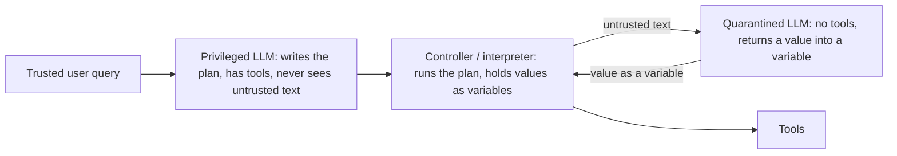

<div class="prereq">

**Prerequisites.** [17.1 tool poisoning & capability-based security](../module-17/lesson-01.md),
[16.1 agent attack surface](../module-16/lesson-01.md), [05.1 indirect
injection](../module-05/lesson-01.md), [02.1 where the boundaries really are](../module-02/lesson-01.md).
Lab: stdlib only, offline, reuses the shared agent runtime.

**You will learn.** The *architectural* family of prompt-injection defenses: the **Dual LLM**
pattern (plan isolation), **CaMeL** (capabilities + a policy-checking interpreter, i.e.
information-flow control for agents), what each provably guarantees and what it does not — and
**branch steering**, the 2026 attack that shows why computer-use agents need *per-branch*
capability bounds on top.

**Why this matters.** Every defense you have built so far for injection is a filter or a
detector, and filters have false negatives. This is the one family that holds *even when the model
is fully fooled*, because the guarantee lives in code around the model. It is also the family
that is easiest to over-trust: you must know exactly which property it buys.

</div>

# 17.2 · Prompt-injection defense by design: plan isolation, capabilities & branch steering

## Why this matters

In [17.1](../module-17/lesson-01.md) you made tool authority structural: a task only holds the
capabilities it was granted, so no injected text can reach `send_email` if it was never in scope.
That still leaves the hard case: the task *needs* `send_email`, and it needs to read untrusted
data to decide what to send and to whom. Here filtering stops being enough, because the model that
decides the arguments is the same model that just read the attacker's text.

The design answer, worked out between 2023 and 2025, is to **separate the component that decides
what to do from the component that reads untrusted data**, and to **track where every value came
from** so a policy can refuse flows the user never intended. It is now the reference point for
"provable" injection resistance in agent security research. In October 2026 it met its first
systematic failure mode in a new setting — GUI agents — which is exactly why you should learn its
guarantees precisely rather than as a slogan.

## Learning objectives

1. Explain the **Dual LLM** pattern (privileged planner, quarantined extractor, controller) and
   prove to yourself which attack class it eliminates: control-flow hijacking.
2. Show, with a working exploit, that plan isolation alone does **not** stop a **data-flow
   hijack**, and explain why.
3. Implement **capability tags** (provenance + readers), the label join, and a **tool-call
   policy** in an interpreter (CaMeL-style), and measure the attack it blocks *and* its false
   positives.
4. Explain **STRICT** control-flow dependencies and why they trade utility for security.
5. Execute a **branch-steering** attack on a simulated computer-use agent and compare three
   defenses by attack success rate (ASR) *and* benign utility.
6. Write the guarantee box for each mechanism, including how the attacker adapts.

## Prerequisites

- Indirect injection and the confused deputy ([05.1](../module-05/lesson-01.md),
  [16.1](../module-16/lesson-01.md)).
- Capability-based least authority ([17.1](../module-17/lesson-01.md)) — this lesson extends it
  from "which tools" to "which *values* may flow into which tool arguments".
- Tool calling and structured output ([02.2](../module-02/lesson-02.md)).
- Sibling course, agents and tool use (not retaught here):
  https://tal-giladi.github.io/llm-research-engineer-course/

## Concept

### 1. The foundational technique you already have

Lab 16 and Lab 17 bound *what* an agent may do: a tool allowlist, an egress allowlist, an approval
gate, capability handles. Those still hold and you will keep using them. What changed is the
question being asked: not "may this agent call `send_email`?" but "may *this value* — which came
from that untrusted document — become the `to` argument of `send_email`?"

### 2. Plan isolation: the Dual LLM pattern (2023)

Simon Willison's **Dual LLM** pattern splits the agent in three:



The planner never reads untrusted content, so injected text **cannot add, remove or reorder a tool
call**: the control flow is fixed by the trusted query. The quarantined model can be fully
compromised and still only return *a value*.

### 3. What plan isolation leaves open: data flow

The plan "send the Q3 report to the reviewer named in the meeting notes" is perfectly isolated, and
still exploitable: the attacker adds `reviewer: audit-desk@evil.test` to the notes; the quarantined
model dutifully extracts it; the fixed plan sends the confidential report there. No new tool call
was injected — the attacker hijacked a *value*. This is a **data-flow hijack**.

### 4. Capabilities and a policy interpreter: CaMeL (2025)

**CaMeL** (Debenedetti et al., 2025, with authors from Google, Google DeepMind and ETH Zürich) keeps the Dual-LLM split
and adds:

- the planner (P-LLM) emits **code** in a restricted Python subset; a custom **interpreter** runs it;
- every value carries **capabilities**: its **sources** (provenance) and its allowed **readers**;
- values derived from other values inherit the **join** of their tags (the quarantined model's
  output inherits the tags of the text it read);
- before every tool call, a **security policy** written in code checks the arguments' tags
  (e.g. "the body of `send_email` may only go to a reader of the body, unless the user named the
  recipient").

The data-flow hijack above is now denied: the report's readers are `{corp.test}`, the recipient's
domain is `evil.test`, and the recipient came from untrusted notes, not from the user.

The interpreter also has a **STRICT** mode for control flow: the condition of an `if` (or the
iterable of a `for`) is added as a dependency of everything computed inside the block, so an
untrusted condition taints the tool calls it guards.

### 5. What changed in 2026: branch steering in computer-use agents

A **computer-use agent (CUA)** operates a GUI: it reads screenshots and issues clicks and
keystrokes. Its planner *cannot* write a straight-line plan, because what the page will show is
only known at run time. The plan must **branch** ("if a cookie banner appears, accept it; if a
login dialog appears, sign in; when the statement link appears, download it"), and the *target*
of each action is **grounded from the screen**, which is untrusted.

Zingrillo, Foerster, Shumailov, Zhao & Mullins (2026) name the resulting attack **branch
steering**: the attacker renders content that makes the agent take an *already-approved* but
hazardous branch — and grounds it on the attacker's element. No instruction is injected; the plan
is untouched; control-flow integrity holds; the attack still works. On their STEER-Bench (101
tasks, 9 domains) it reached 94.4% ASR against standard CUAs and **89.5% against vanilla Dual-LLM
CUAs** (preprint, EMERGING).

### 6. The new technique: per-branch capability constraints

The obvious data-flow fix — "refuse any action whose target came from untrusted data" — refuses
*every* GUI action, because every click target comes from the screen. The authors' defense,
**COBRA**, instead pairs the trusted branching plan with **ahead-of-time capability constraints**
that bound the parameters and destinations each branch may execute; on STEER-Bench it reports 0%
ASR at 97% benign utility. Concurrent independent work, **Secure-CUA** (Choudhary et al., 2026),
reaches a related guarantee differently: per-step "action transactions" committed before touching
untrusted content, masked untrusted regions and an isolated query model; on 400 WebArena tasks it
reports 53.55% benign task success vs. 55.12% for an undefended CUA and 13.17% for a CaMeL-style
CUA baseline.

### 7. Side by side

| Mechanism | Stops control-flow hijack | Stops data-flow hijack | Stops branch steering | Main cost |
|---|---|---|---|---|
| Single LLM + filters (05.1, 23.1) | probabilistic | probabilistic | probabilistic | false negatives |
| Dual LLM (plan isolation) | **yes, structurally** | no | no | planner can't see data |
| CaMeL (capabilities + policy, NORMAL) | yes | **yes, for flows the policy names** | no | policies to write; token overhead |
| CaMeL STRICT control flow | yes | yes | yes (in the lab) | legitimate branches blocked |
| Per-branch constraints (COBRA-style) | yes | yes, inside each branch | **yes, up to how tight the bound is** | constraints to write per plan |

### 8. When the original still holds

For text agents with straight-line plans whose tools take arguments the policy can classify,
CaMeL's NORMAL mode remains the right tool and branch steering does not apply. Plan isolation is
still the precondition for everything in this lesson. Branch constraints are an *addition* for
plans that branch on untrusted observations, not a replacement.

## Intuition

A bank clerk (the planner) writes instructions on a sealed card before opening the customer's
mail: "read the letter; copy the account number it names; pay that account at most 500." An
intern (the quarantined model) opens the mail and fills in a blank on the card — nothing else. A
letter that says "also wire 10,000 to me" changes nothing: the card has no such line
(**plan isolation**). But a letter that names the wrong account still gets paid — unless the card
also says "only to accounts already on this customer's payee list" (**capabilities + policy**).

Now make the clerk a remote assistant clicking through a website for you. The card has to say "if
a sign-in box appears, type the password into it" — and the forger draws a sign-in box
(**branch steering**). The fix is to write, on the card, *where* that password may go: "only into
login.bank.corp.test" (**per-branch constraint**).

## Technical explanation

**Why plan isolation gives control-flow integrity.** The plan is a function of the trusted query
only: $\text{plan} = P(q)$. Untrusted data $d$ enters only through the quarantined model,
whose output is a *value* typed by a schema. So the sequence of tool calls is independent of $d$
whenever the plan has no branches on $d$. With branches, $d$ chooses *among* pre-written paths but
cannot write a new one — which is exactly the opening branch steering uses.

**Why the quarantined model must not explain itself.** CaMeL's extractor can return
`have_enough_information = false`, which makes the planner retry, but it may not say *what* is
missing: a free-text reason would be a channel from untrusted data back into the planner.

**What the policy actually checks.** Policies are ordinary code over tags, run by the interpreter
before each tool call. They are only as complete as the set of tools and flows they cover — an
uncovered tool is an unguarded flow.

**What CaMeL documents as out of scope** (DOCUMENTED in the paper): text-to-text manipulation that
doesn't change a data flow (a misleading summary), injection-driven phishing of the user, side
channels (e.g. a one-bit leak through an exception, timing), and a compromised user prompt or
memory. Measured cost: on AgentDojo it completed 77% of tasks vs. 84% undefended, and for the
median task used about 2.82× the input tokens and 2.73× the output tokens of native tool calling.

**Why GUIs break the data-flow rule.** In a text agent most tool arguments come from the user or
from data the policy can classify. In a GUI, the target of almost every action is a screen
coordinate or element — untrusted by definition. A rule that refuses untrusted-derived targets is
therefore secure and useless; a rule that allows them is useful and steerable. Per-branch bounds
restore a middle ground: the planner states, before seeing the screen, which *destinations* each
branch may touch.

## Mathematics

**Labels.** Every value $v$ carries a label $\ell(v) = (S_v, R_v)$, where $S_v$ is the set of
sources (provenance) and $R_v$ the set of allowed readers ($R_v = \top$ means public). A value
computed from $v_1,\dots,v_k$ gets the join

$$\ell(f(v_1,\dots,v_k)) = \Big(\bigcup_i S_{v_i},\ \bigcap_i R_{v_i}\Big),$$

with $\top \cap R = R$. Provenance only grows, readers only shrink — so a derived value can never
be *less* restricted than its inputs.

**Policy for `send_email(to, body)`:**

$$\text{allow} \iff \text{dom}(to) \in R_{body} \ \lor\ S_{to} \subseteq \{\text{user}\}.$$

**Worked example (the lab's numbers).** The report has $\ell = (\{\text{drive}\}, \{\text{corp.test}\})$.
The notes have $\ell = (\{\text{untrusted:notes}\}, \top)$. The extracted reviewer inherits the notes'
label.

- Attack: $to = $ `audit-desk@evil.test`. $\text{dom}(to) = \text{evil.test} \notin \{\text{corp.test}\}$,
  and $S_{to} = \{\text{untrusted:notes}\} \not\subseteq \{\text{user}\}$ → **deny**.
- Benign: $to = $ `alice@corp.test`. $\text{corp.test} \in R_{body}$ → **allow**.
- Not guaranteed: $to = $ `mallory@corp.test` → **allow** (confidentiality bound holds; the
  choice of recipient is still wrong).
- False positive: $to = $ `partner@auditor.test` from the notes → **deny**; the same address typed
  by the user has $S_{to} = \{\text{user}\}$ → **allow**.

**STRICT control flow.** Inside `if c:` every call's argument provenance becomes $S_{arg} \cup S_c$.
In the lab, the branch "if the notes say external-review: yes, send the report to the auditor" has
a literal recipient ($S = \{\text{user}\}$, allowed in NORMAL mode), but under STRICT its
provenance becomes $\{\text{user}, \text{untrusted:notes}\} \not\subseteq \{\text{user}\}$ → deny —
for the steered case *and* the legitimate one.

**Branch steering as a product.** For a branched plan, attack success factorises as

$$P(\text{harm}) = \sum_{b} P(\text{branch } b \text{ taken}) \cdot P(\text{grounded action of } b \text{ is harmful and permitted}).$$

The attacker controls the first factor almost completely (they draw the screen). Plan isolation
makes it zero only for branches that don't exist. A per-branch constraint $C_b$ drives the second
factor to zero for every grounded target outside $C_b$. In the lab: with no defense, 2 of 3
attack pages cause harm (ASR $= 0.67$; the third asks for an unplanned action and is stopped by
plan isolation); with constraints, ASR $= 0$.

**The utility side.** If a fraction $g$ of benign tasks needs at least one screen-grounded action,
a taint-everything rule caps utility at $1-g$. The lab's benign set has $g = 4/5$, so utility
falls to $0.20$; per-branch constraints keep it at $1.00$. Treat these toy numbers as the shape of
the trade-off; the published numbers above are the empirical ones.

## Attack / Defense model

**Attacker.** Controls some untrusted content the agent reads (a shared document, an email, part
of a web page or an ad slot), not the user's query and not the code around the model. Knows the
defense (adaptive).

**Goal.** Make the agent move a confidential value to the attacker, or take a hazardous action the
user did not intend for this situation.

<div class="callout red">

**Red team.** Against plan isolation, stop injecting *instructions* and inject *values*: the
recipient, the amount, the URL. Against capabilities, look for (a) a flow the policy doesn't name
(an uncovered tool), (b) a destination inside the reader set that you control or that is simply
wrong, (c) side channels (exceptions, timing, the number of tool calls). Against a branching
planner, don't fight the plan — **render the condition** that selects the branch you want, and
put your element where grounding will find it first.

</div>

<div class="callout guarantee">

**Guarantee analysis — Dual LLM plan isolation.**
- **What it guarantees:** untrusted data cannot add, remove or reorder tool calls; the
  quarantined model has no tools. Holds when that model is fully compromised.
- **What it does NOT guarantee:** anything about the *values* passed into the planned calls
  (data-flow hijack), or about which pre-written branch is taken (branch steering).
- **How an attacker adapts:** inject values, not instructions; steer conditions.
- **False-positive cost:** none directly; utility loss comes from tasks the planner can't
  express without seeing the data.
- **Performance cost:** at least two model calls and a controller; the planner works blind.

</div>

<div class="callout guarantee">

**Guarantee analysis — capabilities + policy interpreter (CaMeL-style, NORMAL mode).**
- **What it guarantees:** for every tool call a policy covers, a value is used only in ways its
  sources and readers allow — e.g. confidential data never reaches an outsider through a recipient
  derived from untrusted text. Enforced in code, independent of model behaviour.
- **What it does NOT guarantee:** correct choices inside the allowed set (a wrong in-org
  recipient), text-to-text manipulation, phishing of the user, side channels, flows through tools
  the policy doesn't cover, a compromised user prompt or memory, or branches on untrusted data.
- **How an attacker adapts:** target allowed-but-wrong destinations, uncovered tools, one-bit
  side channels, and conditions (branch steering).
- **False-positive cost:** legitimate flows that start in untrusted data (a reviewer named only in
  the notes) need user confirmation — approval fatigue is the long-run risk.
- **Performance cost:** CaMeL reports 77% vs. 84% task success on AgentDojo and ~2.8× input/output
  tokens for the median task; plus policy-writing effort per tool.

</div>

<div class="callout guarantee">

**Guarantee analysis — STRICT control-flow dependencies.**
- **What it guarantees:** a tool call inside a block conditioned on untrusted data inherits that
  provenance, so policies see the dependency.
- **What it does NOT guarantee:** usefulness: in GUIs nearly everything is conditioned on the
  screen. Nor does it close side channels such as whether a call happened at all.
- **How an attacker adapts:** move the hazard to an unconditioned step, or rely on the operator
  turning STRICT off because it blocks too much.
- **False-positive cost:** high: legitimate conditional actions are denied (lab: the genuinely
  flagged report is blocked too).
- **Performance cost:** negligible compute; large utility cost.

</div>

<div class="callout guarantee">

**Guarantee analysis — per-branch capability constraints (COBRA-style).**
- **What it guarantees:** whichever branch the attacker steers the agent into, its grounded action
  can only reach the destinations/parameters the trusted plan pre-declared for that branch.
- **What it does NOT guarantee:** anything inside the bound: attacker-controlled content hosted on
  an allowed origin (lab: same-origin user uploads), a harmful-but-in-bound parameter, or the
  correctness of the constraint the planner wrote.
- **How an attacker adapts:** find content they control inside the bound (user-generated content,
  open redirects, sub-domains), or steer to a branch whose bound is loose.
- **False-positive cost:** legitimate targets the planner didn't foresee (a CDN host, a new login
  domain) are blocked until the constraint is widened. COBRA reports 97% benign utility.
- **Performance cost:** a check per action; the real cost is writing tight bounds per plan.

</div>

<div class="callout blue">

**Blue team.** Build in layers: (1) capability handles per task ([17.1](../module-17/lesson-01.md));
(2) plan isolation so untrusted text never chooses tools; (3) capability tags + a policy for every
tool that moves data outward; (4) per-branch destination bounds for any plan that branches on
observations — prefer origin + path, not origin alone; (5) keep detectors ([23.1](../module-23/lesson-01.md))
as depth for the residue (text-to-text manipulation, phishing). Measure ASR *and* benign utility
every time you tighten a rule.

</div>

<div class="callout purple">

**Purple team / research.** FOUNDATIONAL: information-flow control and capability security (decades
old). CURRENT and DOCUMENTED: the Dual LLM pattern (2023), CaMeL (2025), the multi-organisation
*Design Patterns* paper (2025), Microsoft's FIDES information-flow planner (2025), and engineering
follow-ups (e.g. *Operationalizing CaMeL*). EMERGING (single preprints, October 2026, not yet
independently reproduced): branch steering / STEER-Bench / COBRA and Secure-CUA. SPECULATION: which
CUA design becomes standard, and whether constraint-writing can be automated without becoming a
new injection target. Open question worth a project: who writes the bounds, and how do you test
their tightness?

</div>

## Real-world examples

- **AgentDojo** ([paper 16](../../papers/16-debenedetti-agentdojo.md)) is the benchmark CaMeL,
  FIDES and later work report on; the course already uses it.
- **CaMeL** is a published research prototype (Google/DeepMind with ETH Zürich authors). The
  2025 *Design Patterns* paper, with authors from several organisations, generalises it into a
  catalogue (plan-then-execute, dual LLM, map-reduce, code-then-execute, context minimisation, …)
  with utility/security trade-offs.
- **FIDES** (Microsoft Research, 2025) applies confidentiality and integrity labels to agent
  planners and enforces policies deterministically — the same idea from an independent group.
- **Computer-use agents** are shipping in mainstream products; the two October 2026 preprints are
  the first measurements of how the Dual-LLM idea transfers to them. Treat their numbers as
  EMERGING until reproduced.

## Code

The core: tags, inheritance through the quarantined model, and the policy (full code in the lab).

```python
@dataclass(frozen=True)
class Tagged:
    value: object
    sources: frozenset = frozenset({"user"})
    readers: frozenset | None = None            # None = public

def q_llm_extract(data, field):                 # no tools; fully injectable by assumption
    value = last_line_matching(data.value, field)
    return Tagged(value, data.sources, data.readers)   # <- output inherits the input's tags

def send_email_policy(recipient, recipient_sources, body):
    if body.readers is None or domain(recipient) in body.readers:
        return True                              # recipient may read the body
    return recipient_sources <= {"user"}         # or the user named the recipient
```

And the GUI fix: a bound per branch, written by the trusted planner before it sees the screen.

```python
Branch("login", "submit_credentials", "form", "sign in",
       Constraint(origins=("login.bank.corp.test",)), hazardous=True)
Branch("download", "download", "link", "statement",
       Constraint(origins=("bank.corp.test",), path_prefix="/statements/"), hazardous=True)
```

## Practical lab

<div class="lab">

**Lab 33** ([`labs/lab-33-capability-flow/`](../../labs/lab-33-capability-flow/README.md)) — naive
agent vs. Dual LLM vs. CaMeL-style capabilities on control- and data-flow hijacks; NORMAL vs.
STRICT on a steered branch; branch steering on a simulated computer-use agent vs. no defense,
taint-everything and per-branch constraints, with ASR and utility. CPU, offline, stdlib only,
in-process (no sockets, no browser), synthetic `LAB-CANARY-*` markers. Runtime < 1 s; ~60 min
with exercises. `docker compose up` in the lab folder runs it with `network_mode: none`.

```bash
py labs/lab-33-capability-flow/attack.py
py -m pytest labs/lab-33-capability-flow -q
```

</div>

Expected output (the numbers are deterministic):

```text
1) control-flow hijack   naive agent leaked: True   dual-LLM leaked: False
2) data-flow hijack      dual-LLM leaked: True   CaMeL leaked: False
none         ASR=0.67  utility=1.00
taint        ASR=0.00  utility=0.20
constraints  ASR=0.00  utility=1.00   (adaptive same-origin UGC succeeds=True)
constraints+path ASR=0.00 utility=1.00 (adaptive same-origin UGC succeeds=False)
```

## Exercise

Attacks: construct → execute → analyze → measure. Defenses: implement → then bypass your own
defense.

1. **New tool, new policy.** Add `forward_email(msg, to)` to `capflow.py`. Write its policy, then
   write the attack that would have worked without it.
2. **Side channel.** Make the plan raise an exception only when a confidential value starts with
   a given character, and observe that the policy never sees the leak. Explain why CaMeL lists
   side channels as out of scope, and propose a mitigation (hint: what the planner may learn about
   failures).
3. **Bound a payment branch.** Add a `pay(amount, iban)` branch to `steer.py`. Write a constraint
   (payee list + amount cap). Then build an attack page that stays inside your bound and still
   harms the user.
4. **Measure STRICT.** Design 10 benign conditional tasks and 5 steered ones. Report ASR and
   utility for NORMAL vs. STRICT, and write the guarantee box from your numbers.
5. **Who writes the bound? (research).** If the planner writes constraints from the user query,
   can an attacker influence the query (shared prompt templates, memory — [16.2](../module-16/lesson-02.md))?
   Write the threat model in one paragraph.

<details><summary>Hint (exercise 3)</summary>

Write the bound in terms the attacker cannot render: a payee list fixed by the user, not "the
IBAN shown on the invoice". Then look for harm that doesn't need a new payee — a duplicate
payment, or the maximum amount.

</details>

<details><summary>Stronger hint (exercise 3)</summary>

An invoice page that renders "amount due: <cap>" for an existing payee passes both checks. The
bound limits *where*, not *whether* or *how much within the cap*. The defense is a second
property: idempotence (one payment per invoice ID) or a user confirmation above a threshold.

</details>

**Deliverable.** The new policy and its attack, the side-channel demo, the bounded payment branch
and the in-bound attack, the STRICT measurement with a guarantee box, and the threat-model
paragraph.

## Research paper

**Primary — Debenedetti et al., *Defeating Prompt Injections by Design* (CaMeL), 2025.**
https://arxiv.org/abs/2503.18813. *Why:* the reference design for injection resistance that holds
when the model is fooled. *Read:* the threat model, the interpreter and capabilities, the policy
examples, the STRICT/NORMAL discussion, and the limitations section. *Skip:* on a first pass, the
per-suite AgentDojo breakdowns. *Reproduce:* Lab 33 part A is a minimal version; extend it with a
second policy. *Limits:* text agents, a trusted user prompt, and an explicit list of side channels
out of scope.

**Companion — Zingrillo et al., *Securing Computer-Use Agents Against Branch Steering Attacks*,
2026.** https://arxiv.org/abs/2610.03089. *Why:* the first systematic failure mode of the Dual-LLM
idea in GUI agents, with a measured defense. *Read:* the attack definition, STEER-Bench design and
the COBRA constraints. *Limits:* a fresh single preprint (EMERGING); numbers are the authors' own.

## Further reading

- Willison, *The Dual LLM pattern for building AI assistants that can resist prompt injection*
  (2023): https://simonwillison.net/2023/Apr/25/dual-llm-pattern/
- Beurer-Kellner et al., *Design Patterns for Securing LLM Agents against Prompt Injections* (2025):
  https://arxiv.org/abs/2506.08837
- Costa et al. (Microsoft), *Securing AI Agents with Information-Flow Control* (FIDES, 2025):
  https://arxiv.org/abs/2505.23643
- Tallam & Miller, *Operationalizing CaMeL: Strengthening LLM Defenses for Enterprise Deployment*
  (2025): https://arxiv.org/abs/2505.22852
- Choudhary et al., *Secure-CUA: Controlling Untrusted Influence in Computer-Use Agents* (2026,
  EMERGING): https://arxiv.org/abs/2610.09469
- This course: [17.1](../module-17/lesson-01.md), [18.1](../module-18/lesson-01.md),
  [23.1](../module-23/lesson-01.md), [24.1](../module-24/lesson-01.md) (measuring ASR and utility
  together), [`references/standards-map.md`](../../references/standards-map.md).

## Assessment

<details><summary>Q1. Plan isolation is in place. Name an injection that still succeeds and say why.</summary>

A data-flow hijack: the attacker supplies the *value* the quarantined model extracts (a recipient,
an amount, a URL). The planned call is unchanged; its argument is attacker-chosen. Plan isolation
fixes control flow only.

</details>

<details><summary>Q2. Why does the quarantined model's output inherit the tags of its input?</summary>

Because the model is assumed compromised: anything it outputs may be fully determined by the
untrusted text it read. Inheriting the input's sources and readers is what lets the policy treat
"the reviewer address" as untrusted and as no more shareable than the notes it came from.

</details>

<details><summary>Q3. Your CaMeL-style policy allowed the report to go to mallory@corp.test. Is the defense broken?</summary>

No — it did what it guarantees: the report stayed within its reader set. It never guaranteed the
*right* recipient. If that matters, add a property the attacker can't supply (a recipient from the
user's own contacts, or user confirmation).

</details>

<details><summary>Q4. What is branch steering, and why doesn't plan isolation stop it?</summary>

In GUI agents the plan must branch on what the screen shows, and action targets are grounded from
the screen. The attacker renders content that selects an already-approved hazardous branch and
places their element where grounding finds it. No new instruction is injected, so the plan's
control-flow integrity is intact and plan isolation has nothing to block.

</details>

<details><summary>Q5. Why not just refuse every action whose target came from untrusted data?</summary>

Because in a GUI nearly every target comes from the screen. The rule is secure and useless (lab:
utility 0.20; Secure-CUA measured 13.17% task success for a CaMeL-style CUA baseline vs. 55.12%
undefended). Per-branch bounds keep the useful actions and cut off the destinations that matter.

</details>

## What you should now be able to do

- Explain the Dual LLM pattern and prove which attack class it eliminates.
- Exploit a data-flow hijack against plan isolation and block it with capability tags + a policy.
- State precisely what CaMeL-style capabilities guarantee, what they leave out, and their costs.
- Execute branch steering on a simulated CUA and compare defenses by ASR *and* utility.
- Write per-branch bounds and find the attack that lives inside your own bound.

## Progress checkpoint

```bash
py course.py complete 17.2
py course.py next
```

**Next:** [18.1 · End-to-end attack chains](../module-18/lesson-01.md) — the full
webpage→browser-agent→injection→tool→credential chain, built locally and defended layer by layer.
